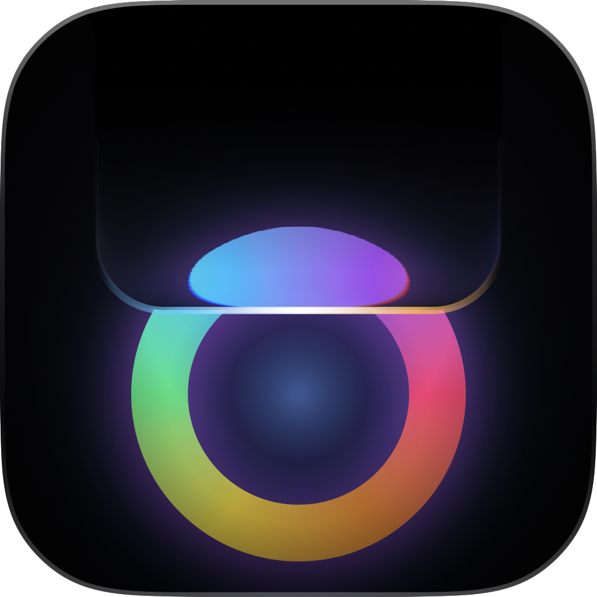

<h1 align="center">
  <br>
  <a href="https://github.com/AllenReder/not-boring-notch"></a>
  <br>
  Not Boring Notch
  <br>
</h1>

<p align="center">
  <em>A heavily modernized, high-performance notch companion for macOS.</em><br>
  <strong>Forked from <a href="https://github.com/TheBoredTeam/boring.notch">TheBoredTeam/boring.notch</a> · Maintained by Allen Reder</strong>
</p>

<p align="center">
  <a href="README.md">English</a> | <a href="README_zh.md">简体中文</a>
</p>

<p align="center">
  <a href="https://github.com/AllenReder/not-boring-notch/actions/workflows/cicd.yml"></a>
  <a href="LICENSE"></a>
  
  
</p>

---

Say hello to **Not Boring Notch**, the coolest way to make your MacBook’s notch the star of the show! 

Forget about static black cutouts: with Not Boring Notch, your notch transforms into a dynamic control center with native **macOS 26 Liquid Glass optical refraction**, an app launcher, live system stats, vibrant visualizers, lyrics, calendar integration, a handy file shelf with AirDrop support, sleek system HUD replacements, and upcoming intelligent workflow companions.

https://github.com/user-attachments/assets/df591b2b-1527-474d-a16f-4bf9b10d9573

---

## ✨ Features

- 💎 **Liquid Glass Surface**: Native CoreAnimation GPU ray-bending refraction, sub-pixel chromatic dispersion, and crystal-clear transparency with zero blur.
- 🚀 **App Launcher**: Summon an app search with `⌥Space`, type a few letters, press Return to open. Five-way name matching, readings of non-Latin names, system recents, and a settings pane of its own.
- 📊 **Stats Tab**: Optional live cards for CPU, GPU, memory, temperature, network, and disk, each with a sparkline of recent history. Sampled only while the tab is visible, inside the App Sandbox.
- 🔔 **Custom Reminder Channel**: Let command-line scripts, automated hooks, and AI agents raise glanceable, dynamic notifications in the notch over a local HTTP port (`127.0.0.1:45999`). Supports auto-adaptive wings, smooth marquee scrolling, in-place status updates without spam, and interactive action buttons. See [docs/reminder-channel.md](docs/reminder-channel.md).
- 🎵 **Media Powerhouse**: Deep integration with Apple Music, Spotify, and YouTube Music. Features real-time lyrics, high-frame-rate spectrogram visualizers, and album art ambient color tinting.
- 📆 **Calendar & Reminders**: Full monthly calendar view, upcoming events, and checkable system Reminders built directly into the notch.
- 📚 **File Shelf**: Drop files into the notch to stage them, quick-look previews, and drag them out anywhere or share via AirDrop.
- 🎚️ **System HUDs**: Sleek Dynamic Island replacements for volume, brightness, backlight, and battery charging animations.
- 🪞 **Notch Mirror & Face**: Built-in camera mirror for quick appearance checks and playful animated notch expressions.

---

### 🚀 The Launcher

Press `⌥Space` and the notch opens on the launcher with the field already focused. Press it again, or press `Esc`, and the notch lets go of it.

- **Type what you remember.** Names are scored five ways — exact, prefix, a word inside, a stretch inside, and finally the letters in order — so `gimp` finds GIMP and the first letters of a long name still find it.
- **Non-Latin names answer to how they read.** 微信 responds to `wei` as a prefix and to `weixin` as letters in order; a reading always ranks below an app actually spelled that way.
- **Recents are the system's recents.** An app opened from the Dock counts as recently used, the list survives restarts, and it steps aside the moment you type.
- **Return opens the highlighted row.** Tune it in **Settings → Launcher**: row height (24–44 pt, icon and name grow with it), how many recents the list opens with, and the shortcut that summons it.

<!-- TODO(image): launcher with a query typed, showing recents above the results -->

### 📊 The Stats Tab

The Stats tab is off by default. Enable it in **Settings → Performance**, and the tab bar starts offering it next to Home, Shelf, and Launch.

- **Six live cards.** CPU, GPU, memory, temperature, network, and disk, each with the current reading, a detail line, and a sparkline of recent history.
- **Sampled only while you are looking.** Readings refresh every 1, 2, or 5 seconds, and only while the tab is visible.
- **Order them your way.** Move cards up or down in Settings; the first three fill the top row and the last three the bottom.
- **No helper, no privileges.** Every metric is sampled in process inside the App Sandbox. Fan speed, power draw, and per-process rankings are not included.

<!-- TODO(image): stats tab showing the six cards -->

---

### 🔔 Quick Start: Sending a Notch Reminder

With Not Boring Notch running, any script or tool can trigger a glanceable notification in your notch via a single `curl`:

```bash
# Read the auto-generated local token
TOKEN=$(cat "$HOME/Library/Containers/com.allenreder.notboringnotch/Data/Library/Application Support/NotBoringNotch/reminder-channel.json" | grep -o '"token" *: *"[^"]*"' | cut -d'"' -f4)

# Raise a reminder
curl -X POST http://127.0.0.1:45999/reminder \
  -H "Authorization: Bearer $TOKEN" \
  -H "Content-Type: application/json" \
  -d '{"icon":{"kind":"sf_symbol","value":"hammer.fill"},"title":"Build Finished","subtitle":"12s"}'
```

For detailed API documentation, custom icon support, and queue behavior, check out the [Reminder Channel Guide](docs/reminder-channel.md).

---

## 🚀 Installation

**System Requirements:**
- macOS **14 Sonoma** or later (macOS 26+ for full Liquid Glass hardware refraction)
- Apple Silicon or Intel Mac

### Install with Homebrew

The easiest way to install and keep Not Boring Notch up to date:

```bash
brew install --cask AllenReder/tap/not-boring-notch
```

The build is ad-hoc signed, so macOS Gatekeeper blocks the first launch. Pass `--no-quarantine` to skip that prompt:

```bash
brew install --cask --no-quarantine AllenReder/tap/not-boring-notch
```

### Download from GitHub Releases

1. Download the latest `.dmg` from [**Releases**](https://github.com/AllenReder/not-boring-notch/releases/latest);
2. Open the `.dmg` and drag **Not Boring Notch** into your `/Applications` folder;
3. On first launch, if macOS Gatekeeper prompts an unidentified developer notice, run this command once in Terminal:
   ```bash
   xattr -dr com.apple.quarantine "/Applications/Not Boring Notch.app"
   ```
4. Launch and enjoy!

---

## 🛠️ Building from Source

### Prerequisites

- macOS 15.0 or later
- Xcode 16.0 or later

### Build Instructions

1. Clone the repository:
   ```bash
   git clone https://github.com/AllenReder/not-boring-notch.git
   cd not-boring-notch
   ```

2. Open the project in Xcode:
   ```bash
   open NotBoringNotch.xcodeproj
   ```

3. Press `Cmd + R` to build and run.

---

## 💖 Acknowledgments & Heritage

This project is open-source under the [GNU General Public License v3.0](LICENSE). We gratefully acknowledge the foundations laid by upstream and community projects:

- **[TheBoredTeam/boring.notch](https://github.com/TheBoredTeam/boring.notch)** – The originating open-source project created by Harsh Vardhan Goswami and contributors.
- **[MediaRemoteAdapter](https://github.com/ungive/mediaremote-adapter)** – High-performance Now Playing source for macOS.
- **[NotchDrop](https://github.com/Lakr233/NotchDrop)** – Inspired the initial concept of the shelf drag-and-drop mechanics.
- **[SkyLightWindow](https://github.com/Lakr233/SkyLightWindow)** – macOS SkyLight window management.
