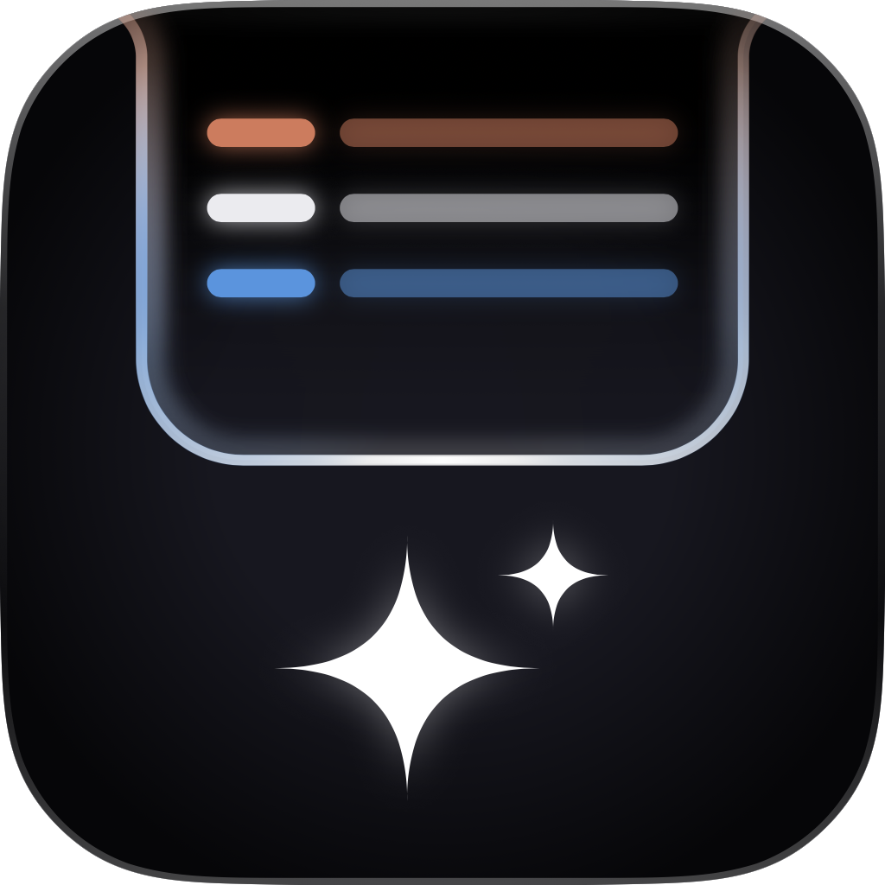

<h1 align="center">
  <br>
  <a href="https://github.com/AllenReder/not-boring-notch"></a>
  <br>
  Not Boring Notch
  <br>
</h1>

<p align="center">
  <em>Your coding agents, your music, and your files, on the MacBook notch.</em><br>
  <strong>Forked from <a href="https://github.com/TheBoredTeam/boring.notch">TheBoredTeam/boring.notch</a> · Maintained by Allen Reder</strong>
</p>

<p align="center">
  <a href="README.md">English</a> | <a href="README_zh.md">简体中文</a>
</p>

<p align="center">
  <a href="https://github.com/AllenReder/not-boring-notch/actions/workflows/cicd.yml"></a>
  <a href="LICENSE"></a>
  
  
</p>

---

**Not Boring Notch** shows your coding agents on the MacBook notch. Claude Code, Codex, pi, and OpenCode report each session to it. You can see which agents are working and which are waiting for you without switching windows, and one click takes you back to the session.

The notch does the rest of what a notch companion does. It shows what's playing with lyrics, holds files on a shelf, opens apps with `⌥Space`, and shows your calendar and system stats. It also replaces the volume and brightness HUDs. On macOS 26 it draws with Liquid Glass refraction.

https://github.com/user-attachments/assets/2630950a-4fdb-4c20-b429-cdabddbc9d02

---

## ✨ Features

- 🤖 **Agents on the Notch**: Claude Code, Codex, pi, and OpenCode sessions on the closed notch. A session turns amber when it needs your approval or an answer, a banner slides out when a turn ends, and one click takes you back to the session's T3 Code thread or terminal. Turn each agent on with one switch in Settings.
- 💎 **Liquid Glass Surface**: Native CoreAnimation GPU ray-bending refraction, sub-pixel chromatic dispersion, and crystal-clear transparency with zero blur.
- 🚀 **App Launcher**: Summon an app search with `⌥Space`, type a few letters, press Return to open. Five-way name matching, readings of non-Latin names, system recents, and a settings pane of its own.
- 📊 **Stats Tab**: Optional live cards for CPU, GPU, memory, temperature, network, and disk, each with a sparkline of recent history. Sampled only while the tab is visible, inside the App Sandbox.
- 🔔 **Notch Channel**: Let command-line scripts, automated hooks, and AI agents send notifications to the notch over a local HTTP port (`127.0.0.1:45999`). A banner slides out of the closed notch, then the notification waits in an Inbox tab until you clear it or click it to jump back to where it came from. Interruption levels, in-place updates by id, withdrawal, and up to three action buttons. See [docs/notch-channel.md](docs/notch-channel.md).
- 🎵 **Media Powerhouse**: Deep integration with Apple Music, Spotify, and YouTube Music. Features real-time lyrics, high-frame-rate spectrogram visualizers, and album art ambient color tinting.
- 📆 **Calendar & Reminders**: Full monthly calendar view, upcoming events, and checkable system Reminders built directly into the notch.
- 📚 **File Shelf**: Drop files into the notch to stage them, quick-look previews, and drag them out anywhere or share via AirDrop.
- 🎚️ **System HUDs**: Sleek Dynamic Island replacements for volume, brightness, backlight, and battery charging animations.

---

### 🤖 Your Agents on the Notch

Leave your agents running in the background. The notch shows you when one of them needs you.

- **Working, waiting, or done.** Each session's mark sits on the closed notch and breathes while the agent works. A session that needs your approval or an answer turns amber and moves to the front.
- **A banner when a turn ends.** The banner shows the first line of the agent's reply. A short turn goes to the Inbox without a banner.
- **One click back.** Click a session, or its notification, to open the T3 Code thread it runs in, or to bring forward the terminal or app that hosts it.
- **Sub-agents count as part of their session.** A task that runs sub-agents ends with one banner, not one per sub-agent.
- **Music and agents share the notch.** With both showing, move the pointer in from the left to open the music, or from the right to open the Inbox.

**Turn it on.** Open **Settings → Notifications** and turn on the switch for each agent you use. The app installs its own entries in that agent's config, repairs them on launch if they change, and removes them when you turn the switch off. It leaves the rest of the config as it was.

**What runs inside your agent.** Claude Code and Codex get a hook that runs a short shell script. pi gets an extension, and OpenCode gets a plugin. Each one sends the agent's events to the app on `127.0.0.1`, and nothing leaves your Mac. The shell script never prints and always exits 0. It gives up after about a second, so it can't stall a turn.

OpenCode sessions started from a terminal can't be traced back to that terminal yet. Clicking one does not jump, and it leaves the list after 15 quiet minutes.

<!-- TODO(image): closed notch with two working agents and one waiting in amber, next to the opened Inbox -->

### 🚀 The Launcher

Press `⌥Space` and the notch opens on the launcher with the field already focused. Press it again, or press `Esc`, and the notch lets go of it.

- **Type what you remember.** Names are scored five ways — exact, prefix, a word inside, a stretch inside, and finally the letters in order — so `gimp` finds GIMP and the first letters of a long name still find it.
- **Non-Latin names answer to how they read.** 微信 responds to `wei` as a prefix and to `weixin` as letters in order; a reading always ranks below an app actually spelled that way.
- **Recents are the system's recents.** An app opened from the Dock counts as recently used, the list survives restarts, and it steps aside the moment you type.
- **Return opens the highlighted row.** Tune it in **Settings → Launcher**: row height (24–44 pt, icon and name grow with it), how many recents the list opens with, and the shortcut that summons it.

<!-- TODO(image): launcher with a query typed, showing recents above the results -->

### 📊 The Stats Tab

The Stats tab is off by default. Enable it in **Settings → Performance**, and the tab bar starts offering it next to Home, Shelf, and Launch.

- **Six live cards.** CPU, GPU, memory, temperature, network, and disk, each with the current reading, a detail line, and a sparkline of recent history.
- **Sampled only while you are looking.** Readings refresh every 1, 2, or 5 seconds, and only while the tab is visible.
- **Order them your way.** Move cards up or down in Settings; the first three fill the top row and the last three the bottom.
- **No helper, no privileges.** Every metric is sampled in process inside the App Sandbox. Fan speed, power draw, and per-process rankings are not included.

<!-- TODO(image): stats tab showing the six cards -->

---

### 🔔 Quick Start: Sending a Notification

With Not Boring Notch running, any script or tool can trigger a glanceable notification in your notch via a single `curl`:

```bash
# Read the auto-generated local token
TOKEN=$(cat "$HOME/Library/Containers/com.allenreder.notboringnotch/Data/Library/Application Support/NotBoringNotch/notch-channel.json" | grep -o '"token" *: *"[^"]*"' | cut -d'"' -f4)

# Send a notification
curl -X POST http://127.0.0.1:45999/v2/notifications \
  -H "Authorization: Bearer $TOKEN" \
  -H "Content-Type: application/json" \
  -d '{"icon":{"kind":"sf_symbol","value":"hammer.fill"},"title":"Build Finished","subtitle":"12s","open":{"app":"com.apple.Terminal"}}'
```

For the full payload, interruption levels, withdrawal, and the v1 `/reminder` route that still works, see the [Notch Channel Guide](docs/notch-channel.md).

---

## 🚀 Installation

**System Requirements:**
- macOS **14 Sonoma** or later (macOS 26+ for full Liquid Glass hardware refraction)
- Apple Silicon or Intel Mac

### Install with Homebrew

The easiest way to install and keep Not Boring Notch up to date:

```bash
brew install --cask AllenReder/tap/not-boring-notch
```

The build is ad-hoc signed and not notarized, so macOS Gatekeeper blocks the first launch. Clear the quarantine flag once after installing:

```bash
xattr -dr com.apple.quarantine "/Applications/Not Boring Notch.app"
```

### Download from GitHub Releases

1. Download the latest `.dmg` from [**Releases**](https://github.com/AllenReder/not-boring-notch/releases/latest);
2. Open the `.dmg` and drag **Not Boring Notch** into your `/Applications` folder;
3. On first launch, if macOS Gatekeeper prompts an unidentified developer notice, run this command once in Terminal:
   ```bash
   xattr -dr com.apple.quarantine "/Applications/Not Boring Notch.app"
   ```
4. Launch and enjoy!

---

## 🛠️ Building from Source

### Prerequisites

- macOS 15.0 or later
- Xcode 16.0 or later

### Build Instructions

1. Clone the repository:
   ```bash
   git clone https://github.com/AllenReder/not-boring-notch.git
   cd not-boring-notch
   ```

2. Open the project in Xcode:
   ```bash
   open NotBoringNotch.xcodeproj
   ```

3. Press `Cmd + R` to build and run.

---

## 💖 Acknowledgments & Heritage

This project is open-source under the [GNU General Public License v3.0](LICENSE). We gratefully acknowledge the foundations laid by upstream and community projects:

- **[TheBoredTeam/boring.notch](https://github.com/TheBoredTeam/boring.notch)** – The originating open-source project created by Harsh Vardhan Goswami and contributors.
- **[MediaRemoteAdapter](https://github.com/ungive/mediaremote-adapter)** – High-performance Now Playing source for macOS.
- **[NotchDrop](https://github.com/Lakr233/NotchDrop)** – Inspired the initial concept of the shelf drag-and-drop mechanics.
- **[SkyLightWindow](https://github.com/Lakr233/SkyLightWindow)** – macOS SkyLight window management.
- **[CodeIsland](https://github.com/wxtsky/CodeIsland)** (MIT) – The agent attention rhythm and hook-installation approach the agent notifications follow.
- **[LobeHub Icons](https://github.com/lobehub/lobe-icons)** (MIT) – The Claude Code and Codex marks. The marks themselves are trademarks of Anthropic and OpenAI.
- **[pi](https://pi.dev)** – The pi mark, from pi.dev. It belongs to pi's authors.
- **[OpenCode](https://github.com/sst/opencode)** (MIT) – The OpenCode mark. It belongs to OpenCode's authors.
