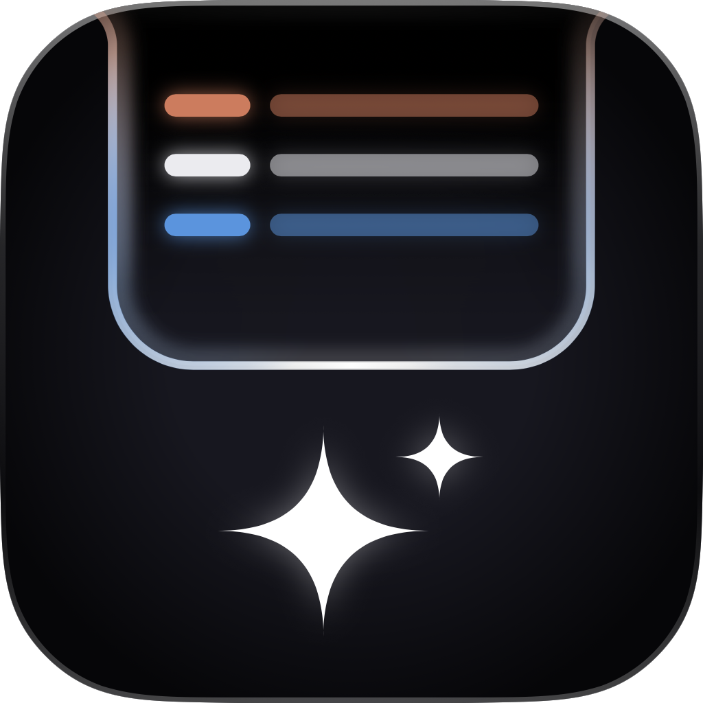

<h1 align="center">
  <br>
  <a href="https://github.com/AllenReder/not-boring-notch"></a>
  <br>
  Not Boring Notch
  <br>
</h1>

<p align="center">
  <em>把你的编程 Agent、音乐和文件，都放进 MacBook 刘海。</em><br>
  <strong>基于 <a href="https://github.com/TheBoredTeam/boring.notch">TheBoredTeam/boring.notch</a> 分叉 · 由 Allen Reder 维护</strong>
</p>

<p align="center">
  <a href="README.md">English</a> | <a href="README_zh.md">简体中文</a>
</p>

<p align="center">
  <a href="https://github.com/AllenReder/not-boring-notch/actions/workflows/cicd.yml"></a>
  <a href="LICENSE"></a>
  
  
</p>

---

**Not Boring Notch** 把你的编程 Agent 显示在 MacBook 刘海上。Claude Code、Codex、pi 和 OpenCode 会把每个会话的状态报给它。不用切换窗口，就能看到哪些 Agent 在干活、哪些在等你；点一下就回到那个会话。

刘海伴侣该有的功能它也都有：显示正在播放的音乐和歌词，在置物架上暂存文件，用 `⌥Space` 打开应用，显示日历和系统状态，替换音量与亮度 HUD。在 macOS 26 上，它用流体玻璃（Liquid Glass）折射渲染。

https://github.com/user-attachments/assets/dc28cce2-7d5e-4bd8-ba9d-8574a08e7f2c

---

## ✨ 核心特性

- 🤖 **刘海上的 Agent (Agents on the Notch)**：Claude Code、Codex、pi 和 OpenCode 的会话显示在闭合刘海上。需要你批准或回答时变成琥珀色，一轮结束时弹出横幅，点一下即可回到会话所在的 T3 Code 线程或终端。每个 Agent 在设置里一个开关即可启用。
- 💎 **流体玻璃质感 (Liquid Glass Surface)**：基于原生 CoreAnimation GPU 光线折射着色器开发，拥有亚像素级色散效果与零模糊的高保真清澈透亮感。
- 🚀 **应用启动器 (App Launcher)**：`⌥Space` 唤起应用搜索，敲几个字母、回车即可打开。五种名称匹配规则、中文名可按读音搜索、系统级最近使用，以及独立的设置面板。
- 📊 **系统监控标签页 (Stats Tab)**：可选开启的 CPU、GPU、内存、温度、网络、磁盘六张实时卡片，每张都带历史走势迷你图。仅在标签页可见时采样，且全程在 App Sandbox 内。
- 🔔 **刘海通道 (Notch Channel)**：允许命令行脚本、自动化钩子和各类 AI Agent 通过本地 HTTP 端口（`127.0.0.1:45999`）向刘海发送通知。通知先以横幅从闭合刘海两侧滑出，随后留在 Inbox 标签页里，直到你清除它，或点击它跳回来源（终端、编辑器、网页）。支持打扰级别、相同 `id` 原地更新、发送方撤回，以及最多三个操作按钮。详见 [docs/notch-channel.md](docs/notch-channel.md)。
- 🎵 **强大的媒体中心 (Media Powerhouse)**：深度集成 Apple Music、Spotify 与 YouTube Music。支持逐字实时歌词、高帧率动态音频频谱仪，以及取自封面配色的氛围光晕。
- 📆 **日历与系统提醒 (Calendar & Reminders)**：完整的月历视图、即将开始的日程，以及可直接在刘海内勾选完成的系统待办事项。
- 📚 **文件置物架 (File Shelf)**：拖拽文件至刘海即可临时置顶暂存，支持空格快速预览（Quick Look），可随时拖出至任意位置或通过 AirDrop 快速分享。
- 🎚️ **灵动系统 HUD (System HUDs)**：用精致的灵动岛动画全面替代音量、亮度、键盘背光与电池充放电提示。

---

### 🤖 刘海上的 Agent (Agents on the Notch)

让 Agent 在后台跑，哪个需要你，刘海会告诉你。

- **在跑、在等、还是做完了。** 每个会话的标记显示在闭合刘海上，Agent 工作时它会呼吸。需要你批准或回答的会话变成琥珀色，并排到最前面。
- **一轮结束时弹出横幅。** 横幅显示 Agent 回复的第一行。很短的一轮不弹横幅，直接进收件箱。
- **点一下回去。** 点击会话或它的通知，会打开它所在的 T3 Code 线程，或把承载它的终端或应用切到前台。
- **子 Agent 算作所属会话的一部分。** 一个跑了多个子 Agent 的任务结束时只弹一条横幅，而不是每个子 Agent 一条。
- **音乐和 Agent 共用刘海。** 两者同时显示时，指针从左边移入打开音乐，从右边移入打开收件箱。

**启用方法。** 打开 **设置 → 通知**，为你用的每个 Agent 打开开关。应用会在该 Agent 的配置里写入自己的条目，启动时如果条目被改动会自动修复，关掉开关时会删除它们。配置里的其他内容保持原样。

**在 Agent 里运行的是什么。** Claude Code 和 Codex 用的是一个 hook，它运行一段简短的 shell 脚本；pi 用的是扩展，OpenCode 用的是插件。它们都只把 Agent 的事件发给 `127.0.0.1` 上的应用，不会有数据离开你的 Mac。那段 shell 脚本从不输出、总是以 0 退出，约一秒后放弃，所以不会拖住 Agent 的任何一轮。

从终端启动的 OpenCode 会话暂时无法追溯到它的终端：点击不会跳转，静默 15 分钟后会从列表中移除。

<!-- TODO(图片)：闭合刘海上两个在跑的 Agent 和一个琥珀色等待中的 Agent，旁边是展开的收件箱 -->

### 🚀 应用启动器 (Launcher)

按 `⌥Space`，刘海会展开到启动器，输入框已自动获得焦点；再次按下同一组合键，或按 `Esc`，刘海即放开键盘。

- **凭印象输入就行。** 名称按五种方式打分——完整、前缀、词内、连续片段，最后是按顺序出现的字母——所以 `gimp` 找得到 GIMP，长名字的首字母也找得到它。
- **中文名可以按读音搜。** 微信响应 `wei`（前缀）也响应 `weixin`（字母按顺序）；音译结果始终排在同名拉丁字母应用之后。
- **最近使用就是系统的最近使用。** 从 Dock 启动的应用同样计入，列表重启后仍在，并且一旦开始输入就让位给搜索结果。
- **回车打开高亮那一行。** 可在 **设置 → 启动器** 里调整：行高（24–44 pt，图标与名称随之缩放）、列表初始展示的最近使用条数，以及唤起快捷键。

<!-- TODO(图片)：输入了关键词的启动器截图，同时展示最近使用与搜索结果 -->

### 📊 系统监控标签页 (Stats Tab)

Stats 标签页默认关闭。在 **设置 → 性能** 中开启后，标签栏会多出一个「统计」标签页。

- **六张实时卡片。** CPU、GPU、内存、温度、网络、磁盘，每张都给出当前读数、一行细节与历史走势迷你图。
- **只在你看的时候采样。** 刷新间隔可选 1、2、5 秒，且仅在标签页可见时进行。
- **顺序由你决定。** 在设置中上下移动卡片；前三张填满上一行，后三张填满下一行。
- **无特权助手。** 所有指标均在 App Sandbox 内进程内采样；暂不支持风扇转速、功耗与分进程排行。

<!-- TODO(图片)：六张卡片的监控标签页截图 -->

---

### 🔔 快速上手：向刘海发送自定义通知

只要 Not Boring Notch 正在运行，任何终端命令或脚本只需一行 `curl` 即可推送通知：

```bash
# 读取沙盒自动生成的本地安全令牌
TOKEN=$(cat "$HOME/Library/Containers/com.allenreder.notboringnotch/Data/Library/Application Support/NotBoringNotch/notch-channel.json" | grep -o '"token" *: *"[^"]*"' | cut -d'"' -f4)

# 发送一条构建完成通知
curl -X POST http://127.0.0.1:45999/v2/notifications \
  -H "Authorization: Bearer $TOKEN" \
  -H "Content-Type: application/json" \
  -d '{"icon":{"kind":"sf_symbol","value":"hammer.fill"},"title":"构建完成","subtitle":"12s","open":{"app":"com.apple.Terminal"}}'
```

完整的参数说明（打扰级别、撤回、点击跳转、操作按钮），以及仍然可用的 v1 `/reminder` 接口，请参阅 [刘海通道接入指南](docs/notch-channel.md)。

---

## 🚀 安装指南

**系统要求：**
- macOS **14 Sonoma** 或更高版本（硬件级流体玻璃折射效果需要 macOS 26+）
- 支持 Apple Silicon (M系列芯片) 及 Intel Mac

### 使用 Homebrew 安装（推荐）

最简单、且能随版本自动更新的安装方式：

```bash
brew install --cask AllenReder/tap/not-boring-notch
```

本项目为 ad-hoc 签名且未经公证，macOS Gatekeeper 会拦截首次启动。安装后运行一次以下命令解除隔离：

```bash
xattr -dr com.apple.quarantine "/Applications/Not Boring Notch.app"
```

### 从 GitHub Releases 下载预编译版本

1. 前往 [**Releases 页面**](https://github.com/AllenReder/not-boring-notch/releases/latest) 下载最新的 `.dmg` 安装包；
2. 打开 `.dmg` 磁盘映像，将 **Not Boring Notch** 拖入你的 `/Applications`（应用程序）文件夹；
3. **首次启动 Gatekeeper 提示处理：**  
   作为开源社区构建版本，首次启动若系统提示“无法打开，因为无法验证开发者”，请在终端（Terminal）中运行一次以下命令解除隔离：
   ```bash
   xattr -dr com.apple.quarantine "/Applications/Not Boring Notch.app"
   ```
4. 打开应用，尽情体验！

---

## 🛠️ 从源码编译

### 环境准备

- macOS 15.0 或更高版本
- Xcode 16.0 或更高版本

### 编译步骤

1. 克隆本仓库：
   ```bash
   git clone https://github.com/AllenReder/not-boring-notch.git
   cd not-boring-notch
   ```

2. 用 Xcode 打开工程：
   ```bash
   open NotBoringNotch.xcodeproj
   ```

3. 按快捷键 `Cmd + R` 即可编译并在本地运行。

---

## 💖 致谢与开源传承

本项目基于 [GNU 通用公共许可证 v3.0 (GPL-3.0)](LICENSE) 开源。我们衷心感谢上游项目及社区奠定的坚实基础：

- **[TheBoredTeam/boring.notch](https://github.com/TheBoredTeam/boring.notch)** – 最初由 Harsh Vardhan Goswami 及贡献者创建的开源灵感之作。
- **[MediaRemoteAdapter](https://github.com/ungive/mediaremote-adapter)** – 高性能 macOS Now Playing 媒体播放监听源。
- **[NotchDrop](https://github.com/Lakr233/NotchDrop)** – 启迪了刘海拖拽置物架的交互灵感。
- **[SkyLightWindow](https://github.com/Lakr233/SkyLightWindow)** – macOS SkyLight 底层窗口管理实现。
